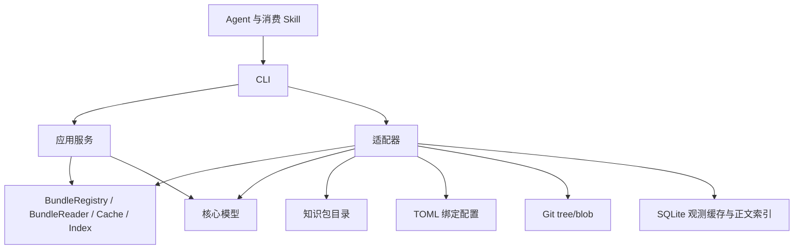

# 设计与实现

本文供开发与维护者了解设计依据、模块职责、当前实现边界及后续工作。命令与格式规则见 [CLI 使用与校验参考](cli-contract.md)，执行证据见 [验证与评测](verification.md)，发行兼容范围见 [安装与发行](releases.md)。

- [架构设计](#架构设计)
- [实现状态](#实现状态)
- [Git 远端实现](#git-远端实现)
- [实施计划](#实施计划)

## 架构设计

okf-cli 读取已绑定的 OKF 知识包，为 Agent 提供概览、目录、元数据候选、正文检索和原文读取。以下说明模块与数据流，命令行为见 [CLI 参考](cli-contract.md)。

### 领域术语

领域定义沿用固定语料对应的 [OKF v0.2 §2](https://github.com/GoogleCloudPlatform/open-knowledge-format/blob/ad30107c31c06aec8a7d5636e0d1058118604e6f/SPEC.md#2-terminology)。

| OKF 概念 | 在本项目中的含义 |
| --- | --- |
| Knowledge Bundle / bundle | 自包含的层级知识包，也是绑定与读取的单位 |
| Concept | 知识包中的一个知识单元，对应一份 Markdown 文档 |
| Concept ID | 文档在知识包内的路径，去掉末尾一个 `.md` |
| Frontmatter / Body | 文件顶部的 YAML 元数据，以及其后的 Markdown 正文 |
| Link | 概念之间的标准 Markdown 链接 |
| Source / Provenance | 概念依据的材料及其集合，记录在 frontmatter 的 `sources` 中 |
| Actor / Trust tier | 生产或核验者标识，以及根据 `verified` 派生的审核层级 |
| Attested Computation / Receipt | 计算定义与执行、核验合同，以及单次运行的记录；静态定义检查与运行核验分别处理 |
| `index.md` / `log.md` | 目录索引与更新历史；它们是保留文件，不是 Concept |

`status`、`stale_after`、`generated`、`verified` 等字段保持规范中的含义。工具执行状态放在响应 envelope 中，与概念元数据分开。

`BundleBinding`、别名、配置作用域、存储适配器、卡片摘要、读取预算、cursor 和缓存是消费工具的扩展。`@handbook/services/auth` 由本地绑定别名 `handbook` 与 Concept ID `services/auth` 组成。存储适配器描述知识包的存储位置；OKF Source 保持依据材料的含义。

### 模块与依赖

项目采用 Rust workspace，启动入口负责组装依赖。

| 模块 | 职责 |
| --- | --- |
| `crates/okf-core` | 逻辑路径、YAML frontmatter、Markdown 链接与脚注、元数据与计算合同诊断、保留文件检查、概念卡片、生命周期、SHA-256、UTF-8 字节分页和 cursor 编解码 |
| `crates/okf-application` | 知识包选择、读取、诊断、同步、检索与上下文选择；定义 `BundleRegistry`、`BundleReader`、`Cache`、`Index` 端口 |
| `crates/okf-adapters` | 文件系统与 Git 对象读取、TOML 配置、SQLite 观测缓存与独立正文索引 |
| `apps/okf-cli` | 参数校验、依赖组装、取消信号、JSON 输出、输出上限和退出码 |
| `skills/okf-cli` | 指导 Agent 调用 CLI、处理覆盖状态和引用原文 |
| `schemas` | 响应 envelope 的 JSON Schema |

核心不执行文件系统、数据库或时钟 I/O。应用通过端口访问知识包和缓存，读取时间与请求控制对象由 CLI 注入。`RequestControl` 使用单调时钟检查截止时间并共享取消信号；`ScanBudget` 在目录打开和迭代器推进前扣减预算。适配器通过 `Listing.complete` 声明列举是否完整，应用决定分页和响应内容。

### 读取流程

1. CLI 解析参数，确定运行目录、项目根目录及配置作用域。
2. 应用从一次配置读取中选择知识包并检查别名歧义；同名绑定要求显式选择作用域。
3. 实时模式通过适配器读取文件系统或固定 Git 提交；索引模式加载已发布 generation。
4. 应用按命令生成概览、目录卡片、搜索候选、正文片段或原文分页。
5. 实时读取概念元数据时更新观测缓存；CLI 序列化响应并检查输出上限。

`context` 探测知识包根目录，`browse` 返回一层目录条目及已发现的作者索引引用。默认 `search` 扫描元数据，`context --query` 复用检索并追加 `read` 入口。`search --full-text` 与 `context --query --content` 从正文索引选择原文片段；`read --indexed` 可离线继续读取同一 generation。

### 文件与模型

知识文件使用 UTF-8 Markdown 和 YAML frontmatter。`Document` 保留 frontmatter 与正文起始偏移；原文由读取流程单独保留，不经渲染重写。概念必须有非空字符串 `type`，未知元数据字段保留。

`YamlValue` 负责 YAML 到 JSON 值的转换，保留解析器支持的 128 位整数和普通映射键，避免扩展字段与 JSON 库的内部数值标记冲突。

概念 ID 为包内路径去掉末尾一个 `.md`；引用格式为 `@别名/路径`。逻辑路径统一使用 `/`，允许 Unicode 和空格，拒绝绝对路径、反斜杠、盘符及 `.`、`..` 路径段。`index.md` 和 `log.md` 是保留资源，不作为普通概念卡片。

`Document::parse` 检查概念结构，`Document::diagnostics` 返回带字段定位的元数据警告，`Document::card` 派生卡片。时间解析和 Actor 规则由诊断与卡片派生共用，具体规则见 [检查矩阵](cli-contract.md#okf-检查矩阵)。应用层提供完整文件引用，将元数据警告与读取故障分别汇入响应，并复用缓存写入流程记录卡片观测。

`Markdown` 使用解析器事件提取正文链接和脚注，保留完整原文件的字节位置。正文路径解析同时确定包内路径与目录导航形式，与 CLI 引用校验分开。应用层复用正文诊断，`validate` 在完整列举后比对目标路径及文件类型，不额外读取目标或访问网络。每份文件的正文警告计数与截断状态统一维护，链接检查完整性与元数据覆盖分别报告。

`Attested Computation` 的字段检查复用元数据诊断器，计算章节检查复用同一轮 Markdown 事件。核心只保留章节状态和诊断所需位置，不复制计算代码。应用层沿用现有命令和响应汇总静态警告；规则与示例集中在 [计算合同与正文](cli-contract.md#计算合同与正文)。

### 检索与关系模型

核心 `Card::search_text` 统一从 id、title、description、type 和 tags 的字段值生成小写检索文本，不将 JSON 字段名或派生状态加入检索词；实时搜索、索引复核与候选派生共用这一语义。实时元数据结果在截断前全局排序。

元数据筛选由应用层共用，实时搜索和索引搜索在截断前应用相同条件。核心 `Sections` 从 Markdown 解析器事件提取标题级别、原文字节范围与显式锚点规则；正文窗口不跨同级或上级章节。每份文档保留一个窗口，不合并不同文件的来源。

`SearchFilter.directory` 限定包内目录。实时模式从目录开始遍历；SQLite 使用路径的二进制范围查询限定统计与候选，在分配多包扫描份额前排除范围外文档。默认索引查询按路径扫描，`SearchFilter.candidate_budget` 可显式启用持久候选选择，再由应用层复核原文匹配与排序。

`candidate_documents` 保存来源哈希及元数据，`candidate_postings` 保存有界字符三元组，`candidate_snapshots` 记录独立派生版本与清单。派生数据和正文同事务发布；写入触发器使事务外的变动失效，最终发布才恢复清单。超过三元组容量的文档进入回退集合，不静默丢弃。元数据先按当前评估时间派生卡片筛选，正文读取和候选行读取分别受限；正文数据库仍为 v1；候选派生数据独立使用版本 2。旧正文库可继续读取，旧版候选数据需重新同步；版本与错误语义见 [候选检索](cli-contract.md#候选检索)。

审核层级与有效期沿用核心卡片派生规则。`SearchFilter` 携带可选评估时间，实时与索引查询分别从原文派生用于选择的卡片；文件观测与缓存时间保持真实请求时间。质量门槛复用验证响应中的诊断和各检查覆盖，在操作诊断汇总后应用，不重新扫描文件。

`neighbors` 从同一 generation 提取直接关系，复用正文链接解析器与索引原始文件。结果带正文位置或来源字段、证据哈希、版本与目标存在性；关系扫描和结果选择分别报告覆盖。所有能力通过 CLI 暴露。

### 配置与缓存

项目配置位于 `.okf-cli/config.toml`，用户配置位于运行目录的 `config.toml`。项目根目录沿当前路径向上查找项目配置或 `.git`；项目内的知识包保存相对路径。配置写入使用系统文件锁和临时文件原子替换。锁文件保持原 inode，进程退出时由系统释放锁。

SQLite 位于运行目录的 `index.sqlite`。`cards` 表按知识包缓存键与文件路径记录内容哈希、卡片 JSON 和观测时间。知识包绑定 ID、类型、根路径及作用域共同参与缓存隔离；Git 缓存键还包含 commit 与包根。

缓存是历史观测记录，`status` 只统计卡片数量和最近观测时间。浏览与搜索仍检查知识包文件；缓存不保存正文，也不承担离线读取或全库完整性判断。

正文索引独立存于 `content.sqlite`，通过 `Index` 端口访问。`sync` 完整扫描并核对内容哈希后，以旧 generation 为比较条件，在事务内替换完整文档清单并发布 generation；扫描或写入失败不发布。即使 generation 未变，也会移除意外残留记录。索引端口分别提供统计、单文档读取、限量概念读取和完整性检查；正文与对应版本在同一事务中取得。`index verify` 使用只读连接逐项检查，在完整扫描后重算快照 generation，预算与取消保留已完成计数。多包查询先根据统计分配扫描份额，再逐包读取并校验 generation，合并带独立来源的候选。统计不载入正文，原文读取不载入无关文件；关系查询仍加载完整有界快照。索引不依赖卡片观测缓存。

Git 绑定保存仓库位置、包根、请求 ref 和已解析 commit。普通读取只访问固定 commit 的 tree/blob；刷新成功后原子替换绑定中的提交。cursor 同时绑定提交和内容修订。远端获取使用独立引用，避免并发获取互相覆盖；不检出、不调用工作区过滤器、不跟随符号链接。gitlink 通过已下载的提交解析为目录；LFS 缓存内容在返回前核对长度和 SHA-256。显式 GC 递归保护当前绑定及其子模块提交，依赖扫描不完整时停止回收。具体边界见 [CLI 参考](cli-contract.md)。

`BundleReader::stat` 为计算声明资源和可选的正文附件检查提供元信息查询。计算资源收集具有独立数量与字节预算；附件检查共用正文链接预算，各自报告检查覆盖。

浏览与检索按条目隔离读取故障，多知识包概览与检索按知识包隔离故障。缓存故障保留已读取内容并附诊断；取消与截止时间停止后续读取。响应分别表达执行结果、知识包覆盖范围与缓存诊断，具体规则见 [CLI 参考](cli-contract.md#故障与覆盖)。

### 路径与一致性

知识包内容保持只读。绑定、缓存与 Skill 安装的写入发生在工具管理的目录中。知识文档里的命令和提示只作为数据读取。

文件系统读取会检查规范化真实路径、文件类型、大小以及读取前后的大小和修改时间。目录遍历拒绝越界路径、目录符号链接、Junction 和大小写碰撞。

文件系统读取视图标记为 `observed`。目录 cursor 校验条目清单的 stat 指纹，原文 cursor 校验完整文件 SHA-256；知识包、操作、目标或版本不匹配时拒绝继续。目录指纹不能检测所有同大小、同修改时间的内容替换，因此不构成固定快照。Git 视图为 `snapshot`，cursor 额外绑定 commit 与包根；索引分页绑定已发布 generation。

具体资源上限与失败语义见 [CLI 参考](cli-contract.md)。

## 实现状态

本节描述当前源码（包括未发布改动）的功能范围与已知边界，不代表已发布附件的能力。执行证据集中在 [验证与评测](verification.md)。

### 功能范围

| 领域 | 范围 |
| --- | --- |
| 知识包 | 本地文件系统与固定 commit 的 Git tree/blob，项目与用户作用域绑定；HTTPS/SSH 仓库获取、凭据引用与显式刷新 |
| 加载 | 知识包概览、一层目录、概念卡片、原文字节分页、索引上的直接入链与出链 |
| 检索 | 实时元数据匹配；同步索引上的正文子串匹配、元数据优先排序、章节内原文片段与任务上下文选择；目录范围、类型、标签、状态、审核层级和有效期筛选，可固定评估时间 |
| 合规 | 概念结构与保留文件检查；元数据、来源脚注、正文路径、包内链接目标、计算合同及声明资源检查；可选附件、图片引用与标题/HTML 锚点检查 |
| 状态 | 元数据派生的审核、文档状态与过期声明 |
| 持久化 | TOML 绑定、SQLite 卡片观测记录与独立正文索引；完整扫描事务发布、并发版本比较、离线原文分页、只读索引完整性检查 |
| Agent | `okf-cli` 消费 Skill 安装与机器可读响应；入口与按需命令参考随 CLI 包和独立 Skill 包提供，历史更名见 [升级说明](releases.md#skill-更名与升级) |
| 执行控制 | 适配器内扫描预算、协作式截止时间和 Ctrl+C 取消 |
| 故障处理 | 多知识包隔离、文件诊断和缓存不可用时保留读取结果 |
| 质量门槛 | 可选警告数量上限；不完整统计返回未知总数和明确的门槛结论 |
| 发行 | 三平台 CLI 包与独立 Agent Skill 包、内嵌构建来源、SHA-256 与 tag 一致性检查；支持平台与发布流程见 [安装与发行](releases.md) |

### 已知边界

- 文件系统是观测视图，不保证固定快照；一致性机制见 [路径与一致性](#路径与一致性)。
- 检索采用确定性子串匹配与原文窗口，不做分词、答案生成或语义冲突判定。正式 Agent 重复对照评测仍待执行，见 [验证记录](verification.md#最近验证)。
- 格式检查不访问外部 URI、不读取附件内容，也不执行计算或核验 Receipt。支持的正文与锚点规则见 [OKF 检查矩阵](cli-contract.md#okf-检查矩阵)。
- 截止时间和取消在检查点生效，不能强制中断已阻塞的系统 I/O、数据库操作或序列化。
- Git 不递归下载嵌套子模块；凭据、下载失败与回收边界见 [Git 远端实现](#git-远端实现)。

参数上限、分页、故障与覆盖状态集中在 [CLI 参考](cli-contract.md)。

### 实现定位

| 机制 | 主要代码 | 回归入口 |
| --- | --- | --- |
| 文件模型、元数据、链接与锚点 | [核心模型](../crates/okf-core/src/lib.rs)、[Markdown](../crates/okf-core/src/markdown.rs)、[章节与锚点](../crates/okf-core/src/sections.rs) | `crates/okf-core/tests` 及模块内测试 |
| 读取、搜索、覆盖与质量门槛 | [应用服务](../crates/okf-application/src/service.rs)、[质量门槛](../crates/okf-application/src/quality.rs) | `crates/okf-application/tests/requests.rs`、`apps/okf-cli/tests/cli.rs` |
| 同步、离线检索与候选索引 | [索引应用](../crates/okf-application/src/index.rs)、[SQLite 索引](../crates/okf-adapters/src/index.rs)、[候选适配器](../crates/okf-adapters/src/candidate_index.rs) | `crates/okf-adapters/tests/index.rs`、`candidates.rs`、生产候选对照脚本 |
| 文件系统与配置 | [文件系统](../crates/okf-adapters/src/filesystem.rs)、[配置](../crates/okf-adapters/src/config.rs) | `crates/okf-adapters/tests/filesystem.rs`、CLI 集成测试 |
| Git 获取与缓存 | [Git 适配器](../crates/okf-adapters/src/git.rs) | Git Rust 测试、HTTPS 及 LFS 完整性脚本 |
| 参数与输出 | [CLI 入口](../apps/okf-cli/src/main.rs)、[响应 Schema](../schemas/response.schema.json) | CLI 集成测试、`scripts/check_schema.py` |

### 当前版本与兼容边界

| 对象 | 当前值或规则 |
| --- | --- |
| workspace 包版本 | `0.3.0`，以根目录 [Cargo.toml](../Cargo.toml) 的 `workspace.package.version` 为准；同版本构建仍需结合 `build-info` 的来源提交区分 |
| 响应 envelope | `schema_version: 2.0` |
| 正文数据库 | SQLite `user_version = 1` |
| 候选派生数据 | 版本 2，只从检索字段值和正文建立候选；响应策略名仍为 `candidates-v1` |
| 旧候选数据 | 版本 1 需重新 `sync`；默认路径检索及索引原文读取仍可使用 |
| 凭据文件路径 | 新绑定保存绝对路径；已有相对路径绑定需按原调用目录确认文件后改成绝对路径 |

正式发行版本与附件以 [GitHub Releases](https://github.com/coolplayagent/okf-cli/releases) 为准，平台、运行库和升级要求见 [安装与发行](releases.md#下载与安装)。workspace 包版本、响应版本和数据库版本分别维护，不应相互推断。

当前源码与历史发行的验收范围不同；已执行的 Debug/Release 回归及跨平台、SSH 和最低系统版本等验证缺口统一记录在 [最近验证](verification.md#最近验证)。

## Git 远端实现

本节补充 Git 获取与缓存的实现机制。参数和错误码见 [CLI 参考](cli-contract.md#git-远端与缓存)，回归入口与结果见 [验证与评测](verification.md)。

### 凭据与传输

凭据配置只保存 `env:VAR` 或 `file:PATH` 引用；新绑定的凭据文件路径按调用目录转为绝对路径保存，旧相对路径绑定需手动校正。Token 在执行时读取并注入 Git 子进程环境。子模块仅在 HTTPS 主机和端口与主仓库完全相同时继承 Token。SCP 地址保持原样，只有 `./`、`../` 开头的地址按主仓库解析。

主仓库 fetch 完成后尝试下载 LFS 和直接子模块对象；普通传输失败允许发布主仓库绑定；存储配额超限、取消和截止时间会阻止新绑定发布，刷新时保留旧绑定。发布前还会检查总存储占用。嵌套子模块不会递归下载，LFS 也不继承 Git HTTP Token。读取只使用本地缓存；LFS 内容返回前检查声明长度和 SHA-256。

### 预算

`--max-git-bytes` 采样检查 Git 与 LFS 对象存储占用。`--max-fetch-bytes` 比较主仓库 fetch 前后的 Git 对象清单，计量新增对象字节；检查发生在后续 LFS、子模块获取之前，不代表整个操作的网络流量。

### 显式 GC

`bundle cache NAME --gc` 与获取、刷新和压缩共用仓库锁：

1. 从当前绑定提交出发，递归扫描 gitlink，去重收集已下载的嵌套子模块提交。
2. 完整扫描后，为这些提交创建临时保护引用；对象缺失、扫描超限或保护失败时不执行回收。
3. 清理不再指向当前绑定提交的 `refs/okf/fetch-*`，执行 `git gc --prune=now`。
4. 删除本轮临时保护引用；下次 GC 重新扫描并建立保护。

Git 自身不会沿 gitlink 保留子模块对象，因此不能仅保护主仓库提交。GC 扫描最多检查 100000 个树条目，服从请求截止时间和取消信号。历史对象默认保留，只有显式 GC 才回收。

## 实施计划

项目定位为面向 Agent 的只读知识消费 CLI。已实现能力见 [实现状态](#实现状态)，命令契约见 [CLI 参考](cli-contract.md)。

### 1. 持续交付验证

对当前未发布改动执行三平台 CI，按新版本完成 tag、发行包及最低操作系统验收。记录对应提交和解压包运行结果，不能复用历史版本结论；已有证据与缺口见 [最近验证](verification.md#最近验证)，流程见 [发行说明](releases.md)。

### 2. 检索规模与任务质量

按 [Agent 消费评测协议](verification.md#agent-cli-消费评测协议) 固定模型版本、费用预算和宿主限制，运行重复对照与答案评分。现有独立 Agent 行为冒烟不能替代正式评测。

用真实大包评估候选倒排交集顺序、多包配额和索引体积，依据收益与退化决定是否改变默认路径扫描策略。比较时保持文件、哈希、字节范围和 generation 可追溯；相同正文预算不代表相同总工作量，检索命中不等于答案正确。

### 3. Git 远端深化

补齐真实 SSH 服务和跨平台传输验证，评估嵌套子模块下载与 LFS 独立认证需求。验收覆盖认证成功与拒绝、传输中断后的重试、配额和取消时保留旧绑定，以及 GC 后可读性。

### 4. 格式与导航兼容

按 [上游兼容检查](verification.md#上游兼容检查) 分类规范与语料差异，补充回归后显式更新固定版本。根据真实语料评估新增锚点规则与自定义 HTML 导航需求，保持关系查询的预算、断链和覆盖语义一致。

### 按需求评估的存储扩展

S3 等新存储适配器待明确使用场景后排期，继续复用 CLI 应用端口。版本条件、分页、重试与下载预算需先定义；不增加普通 OKF 文件的格式要求。
